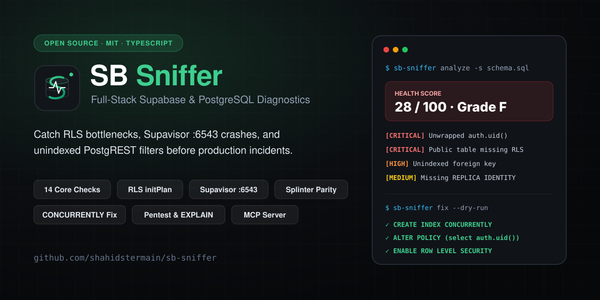
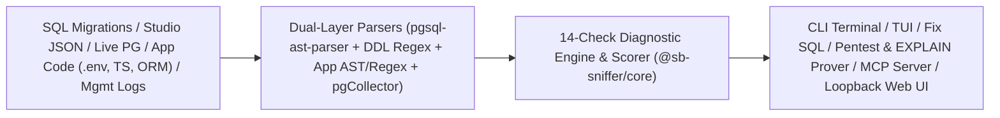

<p align="center">
  
</p>

<h1 align="center">SB Sniffer</h1>

<p align="center">
  <strong>Full-stack security, performance, and schema sniffer for Supabase &amp; PostgreSQL — across migrations, app code, live catalogs, and MCP.</strong>
</p>

<p align="center">
  <a href="https://shahidstermain.github.io/sb-sniffer/">
    
  </a>
  <a href="https://github.com/shahidstermain/sb-sniffer/releases/tag/v1.0.1">
    
  </a>
  <a href="LICENSE">
    
  </a>
  <a href="https://github.com/shahidstermain/sb-sniffer/stargazers">
    
  </a>
</p>

<p align="center">
  
  
  
  
  
</p>

<p align="center">
  <a href="https://shahidstermain.github.io/sb-sniffer/">Live Web Demo</a> ·
  <a href="#try-in-10-seconds">Try in 10s</a> ·
  <a href="#why-developers-use-sb-sniffer">Before / After</a> ·
  <a href="#14-diagnostic-checks">14 Checks</a> ·
  <a href="#commands--workflows">CLI &amp; CI</a> ·
  <a href="#comparison-with-alternatives">Comparison</a> ·
  <a href="docs/ARCHITECTURE.md">Architecture</a>
</p>

---

## Try Live (Zero Credentials)

- **Browser Interactive Demo:** **[https://shahidstermain.github.io/sb-sniffer/](https://shahidstermain.github.io/sb-sniffer/)** — explore the full React diagnostic dashboard or paste your own `.sql` schema / Studio JSON directly in your browser (100% client-side, zero login or DB URI required).

## Try in 10 Seconds

```bash
git clone https://github.com/shahidstermain/sb-sniffer.git && cd sb-sniffer
npm install && npm run build
node packages/cli/dist/index.js analyze --schema sample/schema_dump_broken.sql
```

Want to emit a production-safe migration immediately?

```bash
node packages/cli/dist/index.js fix --schema sample/schema_dump_broken.sql --dry-run
```

---

## Why Developers Use SB Sniffer

Database linters don't scan `.env`, Drizzle, or Next.js SSR code. Application linters don't understand PostgreSQL `initPlan` caching, `pg_constraint`, `pg_stat_statements`, or Supavisor `:6543` transaction pooling. **SB Sniffer inspects the full stack in one pass:**

<table>
<tr>
<th>Real Production Footgun</th>
<th>SB Sniffer Remediation (<code>fix</code> / <code>analyze</code>)</th>
</tr>
<tr>
<td>

**1. Per-row RLS evaluation timeouts**
```sql
CREATE POLICY "user_docs" ON public.documents
  FOR SELECT USING (created_by = auth.uid());
```

</td>
<td>

**Rewritten for PostgreSQL `initPlan` caching:**
```sql
ALTER POLICY "user_docs" ON "public"."documents"
  USING (created_by = (select auth.uid()));
```

</td>
</tr>
<tr>
<td>

**2. Table locks from missing FK / `.eq()` indexes**
```ts
// App calls: supabase.from('documents').eq('organization_id', orgId)
// DB schema: FK lacks a covering B-tree index
```

</td>
<td>

**Lock-safe `CONCURRENTLY` index outside `BEGIN`/`COMMIT`:**
```sql
CREATE INDEX CONCURRENTLY IF NOT EXISTS "idx_documents_organization_id"
ON "public"."documents" USING btree ("organization_id");
```

</td>
</tr>
<tr>
<td>

**3. Supavisor `:6543` & SSR Auth leaks**
```ts
// .env: postgresql://...:6543/postgres (no ?pgbouncer=true)
// drizzle: postgres(url) without { prepare: false }
// server: supabase.auth.getSession()
```

</td>
<td>

**Flagged in app scan (`APP_ENV_AND_DRIVER_MISCONFIG`):**
Appends `?pgbouncer=true`, sets `{ prepare: false }`, enforces server-verified `getUser()`, and blocks client `service_role` leaks.

</td>
</tr>
</table>

---

## Key Capabilities

- **Zero-Credential Static & Studio Modes:** Audit SQL dumps, `supabase/migrations/` directories, application repos (`.env`, Next.js, Prisma, Drizzle), or a single read-only Studio JSON export (`sb-sniffer sql-query`) completely offline.
- **14 Full-Stack Diagnostic Checks:** Covers RLS `initPlan`, missing FK/filter indexes, exposed/locked-out public tables, Supavisor `:6543` vs `:5432` pooler collisions, idle-in-transaction locks, fragile `auth.users` signup triggers, orphaned Storage objects, Realtime `REPLICA IDENTITY`, `pg_stat_statements` hotspots, schema bloat, egress multipliers, and Supabase Splinter security parity.
- **Production-Safe Fix Generator (`fix`):** Outputs `CREATE INDEX CONCURRENTLY IF NOT EXISTS` statements stripped of explicit `BEGIN`/`COMMIT` wrappers.
- **Transaction-Rolled-Back RLS Red Team (`pentest`):** Probes live `public` tables under `SET LOCAL ROLE anon` and `authenticated` inside rolled-back transactions (`BEGIN ... SAVEPOINT ... ROLLBACK`).
- **Evidence-Based Query Proof (`prove`):** Benchmarks `EXPLAIN (ANALYZE, BUFFERS)` before/after candidate fixes inside rolled-back transactions.
- **Web Dashboard, Vim TUI, GitHub Action & MCP Server:** Loopback-hardened HTTP/SSE bridge (`serve`/`web`), split-screen `tui`, live `watch`, PR CI gate (`action.yml`), and stdio MCP server (`mcp`).

---

## Verified Terminal Output

Running `node packages/cli/dist/index.js analyze --schema sample/schema_dump_broken.sql`:

```text
╔═══════════════════════════════════════════════════════════════════╗
║           🕵️‍♂️  SUPABASE DIAGNOSTIC & HEALTH SNIFFER                ║
╚═══════════════════════════════════════════════════════════════════╝

  Timestamp: 11/13/2026, 7:05:02 AM
  Source:    schema_dump

  Health Score: 28/100  [Grade: F]

  Findings Breakdown:
    ● Critical: 2
    ● High:     1
    ● Medium:   2
    ● Info:     0
    Total:      5

  1. CRITICAL  Unwrapped auth.uid() or Helper Functions in RLS Policies
     Check ID: RLS_UNWRAPPED_AUTH_FUNC | Category: rls
     ...
     Copy-Paste SQL Remediation:
       ALTER POLICY "Users can access org documents" ON "public"."documents"
         USING (created_by = (select auth.uid()));
```

---

## 14 Diagnostic Checks

<details open>
<summary><strong>View all 14 checks across 9 categories (including 12 Splinter parity rules)</strong></summary>

| Check ID | Category | Scope | What It Detects |
|---|---|---|---|
| `RLS_UNWRAPPED_AUTH_FUNC` | `rls` | Schema / Live | Unwrapped `auth.uid()`, `auth.jwt()`, `auth.email()`, `current_setting(...)` bypassing `initPlan` caching; redundant permissive policies |
| `RLS_MISSING_INDEX` | `rls` | Schema / Live | Unindexed foreign keys (`pg_constraint`) and RLS equality filter columns (Splinter Rule `0001`) |
| `RLS_DISABLED_OR_LOCKED_OUT` | `rls` | Schema / Live | Exposed `public` tables with RLS disabled (Rules `0007`/`0013`), or RLS enabled with zero policies (Rule `0008`) |
| `POOLER_PORT_AND_PREPARED_STMT_MISMATCH` | `connection_pooler` | Live | Prepared statements colliding with Supavisor `:6543` transaction pooling |
| `CONNECTION_EXHAUSTION_AND_IDLE_LEAKS` | `connection_pooler` | Live | Pool utilization saturation and stuck `idle in transaction` / waiting locks |
| `AUTH_USERS_BLOCKING_TRIGGERS` | `auth` | Schema / Live | Triggers on `auth.users` performing synchronous HTTP calls or missing `EXCEPTION` handlers |
| `STORAGE_ORPHANED_OBJECTS_AND_POLICIES` | `storage` | Live / Schema | Missing `storage.objects` policies and orphaned storage metadata |
| `REALTIME_PUBLICATION_MISCONFIG` | `realtime` | Schema / Live | Tables in `supabase_realtime` missing `REPLICA IDENTITY FULL` or lacking RLS |
| `PG_STAT_STATEMENTS_HOTSPOTS` | `performance` | Live / CSV / JSON | High-time SQL hotspots and poor shared buffer cache hit ratios |
| `SCHEMA_BLOAT_AND_EXTENSIONS_HYGIENE` | `hygiene` | Schema / Live | Extensions (`uuid-ossp`, `pgvector`, `pgcrypto`) installed in `public`, dead-tuple bloat, unused indexes |
| `APP_ENV_AND_DRIVER_MISCONFIG` | `app_code` | App Code | `service_role` exposure in public env vars, `:6543` Prisma/Drizzle prepared statement errors, SSR `auth.getSession()` |
| `APP_QUERY_AND_INDEX_MISMATCH` | `app_code` | Full-Stack | PostgREST `.eq()` filters lacking covering DB B-tree indexes and unbounded `.select('*')` calls |
| `EGRESS_AND_COST_DRIVERS` | `egress_cost` | Schema / App / Live | Egress & compute multipliers (unindexed scans, large `select('*')`, stale stats) |
| `SPLINTER_SECURITY_AND_API_EXPOSURE` | `rls` / `hygiene` | Schema / Live | Supabase Splinter parity: Rules `0002`, `0005`, `0010`, `0011`, `0014`, `0015`, `0016`, `0017` (`SECURITY DEFINER` views, `auth.users` exposure, `user_metadata` RLS, matviews/foreign tables) |

</details>

---

## Commands & Workflows

<details>
<summary><strong>CLI commands, flags, GitHub Action YAML, and MCP integration</strong></summary>

| Command | Purpose | Key Flags |
|---|---|---|
| `analyze` | Audit schema dump, migrations dir, app code, Studio JSON, or live DB | `-s/--schema`, `-a/--app`, `-d/--db`, `--studio-json`, `--stats`, `-f/--format (terminal\|json\|markdown\|sql\|ai\|tui)`, `--fail-on` |
| `fix` | Generate transaction-safe SQL fixes (`CONCURRENTLY`, no `BEGIN`/`COMMIT`) | `-s/--schema`, `-d/--db`, `-a/--app`, `--out-dir`, `--dry-run` |
| `pentest` | Transaction-rolled-back RLS probe as `anon` & `authenticated` | `-d/--db` (required), `-w/--writes`, `-f/--format (terminal\|json)` |
| `prove` | Rolled-back `EXPLAIN (ANALYZE, BUFFERS)` query benchmark | `-d/--db` (required), `-l/--limit`, `-f/--format (terminal\|json)` |
| `watch` | Real-time terminal monitor for locks & pool saturation | `-d/--db` (required), `-i/--interval` |
| `serve` / `web` | Start loopback HTTP/SSE telemetry bridge & React Web UI | `-p/--port`, `--host`, `-d/--db`, `--no-open` |
| `tui` | Vim-navigable split-screen terminal UI (`j`/`k`/`q`) | `-s/--schema`, `-d/--db` |
| `sql-query` | Print the single read-only Studio introspection SQL query | — |
| `demo` | Run full-stack showcase against the preloaded broken SaaS snapshot | `-f/--format`, `-o/--out` |
| `mcp` | Start stdio MCP server exposing `analyze_schema`, `scan_app_code`, `generate_safe_migration` | — |

### GitHub Actions CI Gate

```yaml
name: Supabase Diagnostics
on: [pull_request]

jobs:
  sb-sniffer:
    runs-on: ubuntu-latest
    steps:
      - uses: actions/checkout@v4
      - uses: shahidstermain/sb-sniffer@v1.0.1
        with:
          schema-path: supabase/migrations
          app-dir: .
          fail-on: critical
```

### Model Context Protocol (MCP) Integration

```json
{
  "mcpServers": {
    "sb-sniffer": {
      "command": "node",
      "args": ["/absolute/path/to/sb-sniffer/packages/cli/dist/index.js", "mcp"]
    }
  }
}
```

</details>

---

## Architecture



- `packages/core` (`@sb-sniffer/core`) — Pure TypeScript analysis engine (runs identically in Node CLI, MCP, CI, and browser).
- `packages/cli` (`sb-sniffer`) — Commander CLI, `pgCollector` (`pg_constraint` + smart TLS/URI handling), loopback HTTP/SSE bridge, `pentest`, `prove`, `tui`, and `mcp`.
- `packages/web` (`@sb-sniffer/web`) — Client-side React 19 + Vite + Tailwind diagnostic UI ([try live demo](https://shahidstermain.github.io/sb-sniffer/)).

---

## Comparison with Alternatives

| Capability | SB Sniffer | Supabase Splinter (`db lint`) | Generic SQL Linters (`squawk`, `sqlfluff`) |
|---|---|---|---|
| **Static SQL + Migration Parsing** | Yes (AST + DDL fallback) | Requires live Postgres | Yes |
| **RLS `initPlan` (`auth.uid()`) & Splinter Rules** | Yes (12+ Splinter rules + deep RLS) | Yes | Partial / Generic |
| **App Code Correlation (`.env`, `:6543`, Drizzle/Prisma, `select('*')`)** | Yes | No | No |
| **Rolled-Back RLS `pentest` & `EXPLAIN prove`** | Yes | No | No |
| **Safe `CONCURRENTLY` Migration Generator (`fix`)** | Yes | No | No |
| **Live Pooler / `pg_stat_statements` / Management Logs Bridge** | Yes | No | No |
| **Web UI Demo + Vim TUI + Stdio MCP Server** | Yes | CLI / Studio only | CLI only |

SB Sniffer complements `supabase db lint` by shifting checks left to offline PRs, auditing `.env`/ORM/PostgREST code alongside Postgres schemas, generating `CONCURRENTLY` fixes, and bundling live telemetry triage.

---

## Installation, Limitations & Docs

- **Local Install:** `git clone https://github.com/shahidstermain/sb-sniffer.git && cd sb-sniffer && npm install && npm run build && ./install.sh` (Node.js `>= 18`, macOS/Linux/WSL2, Postgres 14–17).
- **Limitations:** Dynamically generated SQL (`EXECUTE '...'`) inside PL/pgSQL requires live DB or Studio JSON mode; Management API log fetching requires `SUPABASE_ACCESS_TOKEN`; run `prove` (`EXPLAIN ANALYZE`) against staging or replicas for heavy workloads; npm package distribution is planned on the roadmap.
- **Full Documentation:** [Architecture](docs/ARCHITECTURE.md) · [Technical Spec](docs/TECHNICAL_DOCUMENTATION.md) · [Configuration](docs/CONFIGURATION.md) · [Troubleshooting](docs/TROUBLESHOOTING.md) · [FAQ](docs/FAQ.md) · [Changelog](CHANGELOG.md)

## Contributing & Community

If SB Sniffer catches a bottleneck or saves a support escalation, consider giving the repo a **Star** — it helps other Supabase and Postgres developers discover the tool.

- Pick up a starter task in [Good First Issues](https://github.com/shahidstermain/sb-sniffer/labels/good%20first%20issue)
- Read [CONTRIBUTING.md](CONTRIBUTING.md) and our [Code of Conduct](CODE_OF_CONDUCT.md)
- Share feedback in [GitHub Discussions](https://github.com/shahidstermain/sb-sniffer/discussions) · Report security issues privately via [SECURITY.md](SECURITY.md)

## License

[MIT License](LICENSE)
