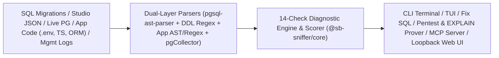

<p align="center">
  
</p>

<h1 align="center">SB Sniffer</h1>

<p align="center">
  <strong>Full-stack open-source diagnostic, security, and performance sniffer for Supabase and PostgreSQL projects.</strong>
</p>

<p align="center">
  <a href="#quick-start-5-minutes">Quick Start</a> ·
  <a href="#14-diagnostic-checks">14 Checks</a> ·
  <a href="#commands--workflows">Commands</a> ·
  <a href="#architecture">Architecture</a> ·
  <a href="#comparison-with-alternatives">Comparison</a> ·
  <a href="docs/ARCHITECTURE.md">Architecture Docs</a> ·
  <a href="CONTRIBUTING.md">Contributing</a>
</p>

---

## What Is SB Sniffer?

**SB Sniffer** inspects your Supabase schema migrations, application codebase (`.env`, Next.js, Prisma, Drizzle, `supabase-js`), live PostgreSQL catalogs (`pg_stat_statements`, `pg_stat_activity`, `pg_constraint`), and Management API logs in one pass — surfacing concrete root causes and generating production-safe SQL fixes.

## The Problem It Solves

Most Supabase production incidents sit across the boundary between **PostgreSQL**, **PostgREST**, **Supavisor**, **GoTrue**, and **application code**:

- An RLS policy calls `auth.uid()` without `(select auth.uid())`, preventing PostgreSQL `initPlan` caching and turning index seeks into sequential scans.
- An app passes a `:6543` Supavisor transaction-mode connection string to Prisma without `?pgbouncer=true` or Drizzle without `{ prepare: false }`, triggering intermittent prepared statement failures under load.
- Foreign keys or `.eq()` filters queried from `supabase-js` lack covering B-tree indexes, saturating the connection pooler with `504` timeouts.
- Client code leaks `service_role` in `NEXT_PUBLIC_*` / `VITE_*` variables, calls `supabase.auth.getSession()` on SSR servers, or triggers egress spikes with unbounded `.select('*')`.
- Generated migrations wrap `CREATE INDEX CONCURRENTLY` inside explicit `BEGIN`/`COMMIT` transaction blocks, failing at deploy time.

Database-only linters miss `.env` and ORM misconfigurations; app linters miss `pg_constraint`, `pg_stat_statements`, and Supavisor session leaks. **SB Sniffer correlates both layers together.**

## Key Capabilities

- **Zero-Credential Static & Studio Modes**: Audit SQL dumps, `supabase/migrations/` directories, application repos, or a single read-only Studio JSON export completely offline.
- **14 Full-Stack Diagnostic Checks**: Covers RLS performance & lockouts, missing FK/filter indexes, Supavisor `:6543` vs `:5432` mismatches, idle-in-transaction leaks, fragile `auth.users` triggers, orphaned Storage objects, Realtime `REPLICA IDENTITY`, `pg_stat_statements` cache/buffer hotspots, schema hygiene, egress drivers, and Supabase Splinter parity.
- **Production-Safe Fix Generation (`fix`)**: Emits `CREATE INDEX CONCURRENTLY IF NOT EXISTS` statements and strips explicit `BEGIN`/`COMMIT` wrappers so indexes build without locking production tables.
- **Transaction-Rolled-Back RLS Red Team (`pentest`)**: Probes live `public` tables under `SET LOCAL ROLE anon` and `authenticated` inside rolled-back transactions to verify actual row-level isolation.
- **Evidence-Based Query Proof (`prove`)**: Benchmarks `EXPLAIN (ANALYZE, BUFFERS)` inside rolled-back transactions to validate index or `initPlan` remediation impact.
- **Loopback Web GUI, Vim TUI & MCP Server**: Includes a React Web dashboard (`serve` / `web`), interactive terminal UI (`tui`), real-time lock watcher (`watch`), CI GitHub Action (`action.yml`), and a stdio Model Context Protocol server (`mcp`).

---

## 14 Diagnostic Checks

| Check ID | Category | Scope | What It Detects |
|---|---|---|---|
| `RLS_UNWRAPPED_AUTH_FUNC` | `rls` | Schema / Live | Unwrapped `auth.uid()`, `auth.jwt()`, `auth.email()`, `current_setting(...)` bypassing `initPlan` caching; redundant permissive policies |
| `RLS_MISSING_INDEX` | `rls` | Schema / Live | Unindexed foreign keys (`pg_constraint`) and RLS equality filter columns (Splinter Rule `0001`) |
| `RLS_DISABLED_OR_LOCKED_OUT` | `rls` | Schema / Live | Exposed `public` tables with RLS disabled (Rules `0007`/`0013`), or RLS enabled with zero policies (Rule `0008`) |
| `POOLER_PORT_AND_PREPARED_STMT_MISMATCH` | `connection_pooler` | Live | Prepared statements colliding with Supavisor `:6543` transaction pooling |
| `CONNECTION_EXHAUSTION_AND_IDLE_LEAKS` | `connection_pooler` | Live | Pool utilization saturation and stuck `idle in transaction` / waiting locks |
| `AUTH_USERS_BLOCKING_TRIGGERS` | `auth` | Schema / Live | Triggers on `auth.users` performing synchronous HTTP calls or missing `EXCEPTION` error handlers |
| `STORAGE_ORPHANED_OBJECTS_AND_POLICIES` | `storage` | Live / Schema | Missing `storage.objects` policies and orphaned storage metadata |
| `REALTIME_PUBLICATION_MISCONFIG` | `realtime` | Schema / Live | Tables in `supabase_realtime` missing `REPLICA IDENTITY FULL` or lacking RLS |
| `PG_STAT_STATEMENTS_HOTSPOTS` | `performance` | Live / CSV / JSON | High-time SQL hotspots and poor shared buffer cache hit ratios |
| `SCHEMA_BLOAT_AND_EXTENSIONS_HYGIENE` | `hygiene` | Schema / Live | Extensions (`uuid-ossp`, `pgvector`, `pgcrypto`) installed in `public`, dead-tuple bloat, unused indexes |
| `APP_ENV_AND_DRIVER_MISCONFIG` | `app_code` | App Code | `service_role` exposure in public env vars, `:6543` Prisma/Drizzle prepared statement errors, SSR `auth.getSession()` |
| `APP_QUERY_AND_INDEX_MISMATCH` | `app_code` | Full-Stack | PostgREST `.eq()` filters lacking covering DB B-tree indexes and unbounded `.select('*')` calls |
| `EGRESS_AND_COST_DRIVERS` | `egress_cost` | Schema / App / Live | Egress & compute multipliers (unindexed high-cardinality scans, large `select('*')`, stale stats) |
| `SPLINTER_SECURITY_AND_API_EXPOSURE` | `rls` / `hygiene` | Schema / Live | Supabase Splinter parity: Rules `0002`, `0005`, `0010`, `0011`, `0014`, `0015`, `0016`, `0017` (`SECURITY DEFINER` views, `auth.users` exposure, `user_metadata` RLS, matviews/foreign tables) |

---

## Installation

**Requirements:** Node.js `>= 18` and npm.

### Option 1: Install from Source (Recommended)

```bash
git clone https://github.com/shahidstermain/sb-sniffer.git
cd sb-sniffer
npm install
npm run build
npm test
```

Run directly via Node or link the global `sb-sniffer` binary:

```bash
# Run directly without linking
node packages/cli/dist/index.js --help

# Or link globally with npm / 1-click installer
./install.sh
```

---

## Quick Start (5 Minutes)

### 1. Run Offline Against the Included Broken Schema Sample

```bash
node packages/cli/dist/index.js analyze \
  --schema sample/schema_dump_broken.sql \
  --format terminal
```

Actual sample output:

```text
╔═══════════════════════════════════════════════════════════════════╗
║           🕵️‍♂️  SUPABASE DIAGNOSTIC & HEALTH SNIFFER                ║
╚═══════════════════════════════════════════════════════════════════╝

  Timestamp: 11/13/2026, 7:05:02 AM
  Source:    schema_dump

  Health Score: 28/100  [Grade: F]

  Findings Breakdown:
    ● Critical: 2
    ● High:     1
    ● Medium:   2
    ● Info:     0
    Total:      5

  1. CRITICAL  Unwrapped auth.uid() or Helper Functions in RLS Policies
     Check ID: RLS_UNWRAPPED_AUTH_FUNC | Category: rls
     Summary:  3 policy/policies call auth helpers directly without a (select ...) wrapper...
     Copy-Paste SQL Remediation:
       ALTER POLICY "Users can access org documents" ON "public"."documents"
         USING (created_by = (select auth.uid()));
...
```

### 2. Full-Stack Audit (Migrations + Application Code)

```bash
node packages/cli/dist/index.js analyze \
  --schema supabase/migrations \
  --app . \
  --fail-on critical
```

### 3. Generate a Production-Safe Remediation Migration

```bash
# Preview SQL cleanly without modifying files
node packages/cli/dist/index.js fix \
  --schema sample/schema_dump_broken.sql \
  --dry-run

# Or write a timestamped migration to supabase/migrations/
node packages/cli/dist/index.js fix \
  --schema supabase/migrations \
  --app .
```

### 4. Launch the Local Web Dashboard

```bash
node packages/cli/dist/index.js web --port 3001
```

- Opens `http://127.0.0.1:3001` cleanly bound to loopback (`127.0.0.1`).
- Use **Zero-Credential Studio Mode** (copy a single read-only SQL query from `sql-query`, run it in Supabase Studio SQL Editor, paste the resulting JSON) or connect to a live Postgres/Supabase URI.

---

## Commands & Workflows

| Command | Purpose | Key Flags |
|---|---|---|
| `analyze` | Audit schema dump, migrations dir, app code, Studio JSON, or live DB | `-s/--schema`, `-a/--app`, `-d/--db`, `--studio-json`, `--stats`, `-f/--format (terminal\|json\|markdown\|sql\|ai\|tui)`, `--fail-on` |
| `fix` | Generate transaction-safe SQL fixes (`CONCURRENTLY`, no `BEGIN`/`COMMIT`) | `-s/--schema`, `-d/--db`, `-a/--app`, `--out-dir`, `--dry-run` |
| `pentest` | Transaction-rolled-back RLS probe as `anon` & `authenticated` | `-d/--db` (required), `-w/--writes`, `-f/--format (terminal\|json)` |
| `prove` | Rolled-back `EXPLAIN (ANALYZE, BUFFERS)` query benchmark | `-d/--db` (required), `-l/--limit`, `-f/--format (terminal\|json)` |
| `watch` | Real-time terminal monitor for locks & pool saturation | `-d/--db` (required), `-i/--interval` |
| `serve` / `web` | Start loopback HTTP/SSE telemetry bridge & React Web UI | `-p/--port`, `--host`, `-d/--db`, `--no-open` |
| `tui` | Vim-navigable split-screen terminal UI (`j`/`k`/`q`) | `-s/--schema`, `-d/--db` |
| `sql-query` | Print the single read-only Studio introspection SQL query | — |
| `demo` | Run full-stack showcase against the preloaded broken SaaS snapshot | `-f/--format`, `-o/--out` |
| `mcp` | Start stdio MCP server exposing `analyze_schema`, `scan_app_code`, `generate_safe_migration` | — |

### GitHub Actions CI Gate

Reference the composite action in your workflow (``.github/workflows/supabase-check.yml``):

```yaml
name: Supabase Diagnostics
on: [pull_request]

jobs:
  sb-sniffer:
    runs-on: ubuntu-latest
    steps:
      - uses: actions/checkout@v4
      - uses: shahidstermain/sb-sniffer@v1.0.0
        with:
          schema-path: supabase/migrations
          app-dir: .
          fail-on: critical
```

### Model Context Protocol (MCP) Integration

Register `sb-sniffer mcp` with an MCP-compatible coding assistant:

```json
{
  "mcpServers": {
    "sb-sniffer": {
      "command": "node",
      "args": ["/absolute/path/to/sb-sniffer/packages/cli/dist/index.js", "mcp"]
    }
  }
}
```

Tools exposed over stdio: `analyze_schema`, `scan_app_code`, `generate_safe_migration`.

---

## Architecture



Monorepo workspaces:

- `packages/core` (`@sb-sniffer/core`) — Parsers (`schemaDumpParser`, `studioJsonParser`, `statStatementsParser`, `appCodeParser`), `STUDIO_INTROSPECTION_SQL`, all 14 checks, scoring engine, markdown/SQL/AI formatters.
- `packages/cli` (`sb-sniffer`) — Commander CLI, `pgCollector`, loopback HTTP/SSE bridge (`liveServer`), `rlsPentester`, `explainProver`, `liveWatch`, `linuxTui`, `mcpServer`.
- `packages/web` (`@sb-sniffer/web`) — React 19 + Vite + Tailwind web dashboard, Studio JSON uploader, live Postgres telemetry panel, log checker.

See [docs/ARCHITECTURE.md](docs/ARCHITECTURE.md) and [docs/TECHNICAL_DOCUMENTATION.md](docs/TECHNICAL_DOCUMENTATION.md) for deep technical details.

---

## Comparison with Alternatives

| Capability | SB Sniffer | Supabase Splinter (`db lint`) | Generic SQL Linters (`squawk`, `sqlfluff`) |
|---|---|---|---|
| **Static SQL + Migration Parsing** | Yes (AST + DDL fallback) | Requires live Postgres | Yes |
| **Supabase RLS `initPlan` (`auth.uid()`) & Splinter Rules** | Yes (12+ Splinter rules + deep RLS) | Yes | Partial / Generic |
| **App Code Correlation (`.env`, `:6543`, Drizzle/Prisma, `select('*')`)** | Yes | No | No |
| **Transaction-Rolled-Back RLS `pentest` & `EXPLAIN prove`** | Yes | No | No |
| **Production-Safe `CONCURRENTLY` Migration Generator (`fix`)** | Yes | No | No |
| **Live Pooler / `pg_stat_statements` / Management Logs Bridge** | Yes | No | No |
| **Local Web UI + Vim TUI + Stdio MCP Server** | Yes | CLI / Dashboard only | CLI only |

**When to use official `supabase db lint` alongside SB Sniffer:** Supabase CLI + Splinter remains the canonical upstream Postgres catalog linter inside `supabase start`. SB Sniffer complements it by scanning offline migrations, catching `.env` / ORM / SSR full-stack bugs before deploy, generating `CONCURRENTLY`-safe fix migrations, and bundling live session/log diagnostics into one tool.

---

## Supported Platforms

- **Runtime**: Node.js 18, 20, 22, 24+ (tested in CI on Node 20 & 22)
- **Operating Systems**: macOS, Linux, Windows (via WSL2 or Node.js)
- **Databases**: PostgreSQL 14–17, Supabase Cloud (Supavisor `:6543` and Direct `:5432`), Self-Hosted Supabase, Local `supabase start`

---

## Limitations

- **Dynamic SQL / PL/pgSQL Control Flow**: Static schema parsing resolves standard DDL (`CREATE TABLE`, `CREATE POLICY`, `CREATE TRIGGER`, `ALTER TABLE`, `CREATE PUBLICATION`, `CREATE VIEW`, `CREATE INDEX`). Dynamically constructed `EXECUTE '...'` DDL inside DO blocks is only visible in live DB or Studio JSON mode.
- **Management API Logs (`pg_logs` / `supavisor_logs`)**: Live log fetching requires `SUPABASE_ACCESS_TOKEN` and `SUPABASE_PROJECT_REF` configured on the bridge server process; without them, static and live Postgres checks still operate normally.
- **`EXPLAIN (ANALYZE, BUFFERS)` (`prove`)**: Executes candidate `SELECT` plans inside rolled-back transactions (`BEGIN ... ROLLBACK`). Prefer staging or read-replicas for heavy analytical queries.
- **Package Distribution**: Not yet published to npm; install by cloning this repository or via release tarballs.

---

## Documentation Index

- [Quick Reference & Technical Spec](docs/TECHNICAL_DOCUMENTATION.md)
- [Architecture Deep Dive](docs/ARCHITECTURE.md)
- [Configuration & Environment Variables](docs/CONFIGURATION.md)
- [Troubleshooting Guide](docs/TROUBLESHOOTING.md)
- [Frequently Asked Questions](docs/FAQ.md)
- [Changelog](CHANGELOG.md)

## Roadmap

- Optional SARIF output format for native GitHub Code Scanning PR annotations
- Expanded PostgREST `.rpc()` security and `SECURITY DEFINER` privilege graph checks
- Workspace `.sbsnifferrc.json` config support for rule suppression and custom severity overrides
- Published npm package (`npx sb-sniffer`) once v1.x feedback settles

## Contributing & Support

- Contributions are welcome — please read [CONTRIBUTING.md](CONTRIBUTING.md) and our [Code of Conduct](CODE_OF_CONDUCT.md).
- Bug reports and feature requests: [GitHub Issues](.github/ISSUE_TEMPLATE).
- Security vulnerabilities: see [SECURITY.md](SECURITY.md) (report privately, never via public issues).

## License

Released under the [MIT License](LICENSE).
