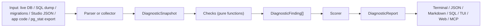

# SB Sniffer — Technical Documentation

> Diagnostic and health analyzer for Supabase projects (`sb-sniffer`, v1.0.0).
> It inspects a Postgres schema, a live database, application code, query statistics and logs, then reports prioritized findings with explanations and copy-pasteable SQL fixes.

## Table of contents
1. [Overview](#1-overview)
2. [Architecture](#2-architecture)
3. [Data model](#3-data-model)
4. [Input sources](#4-input-sources)
5. [Diagnostic checks](#5-diagnostic-checks)
6. [Scoring](#6-scoring)
7. [CLI reference](#7-cli-reference)
8. [Web app and bridge server](#8-web-app-and-bridge-server)
9. [Live logs](#9-live-logs)
10. [MCP server](#10-mcp-server)
11. [CI integration](#11-ci-integration)
12. [Setup and development](#12-setup-and-development)
13. [Testing](#13-testing)
14. [Security considerations](#14-security-considerations)
15. [Known limitations](#15-known-limitations)
16. [Extending the app](#16-extending-the-app)

---

## 1. Overview

SB Sniffer finds the problems that most often cause Supabase support tickets, for example RLS policies that force per-row function calls, tables with RLS off, unindexed foreign keys, pooler misconfiguration, blocking auth triggers and runaway connections.

The pipeline is the same for every input:



## 2. Architecture

npm workspaces monorepo (`packages/*`, TypeScript, ESM).

| Package | Name | Role |
|---|---|---|
| `packages/core` | `@sb-sniffer/core` | Pure diagnostic engine: types, parsers, checks, scoring, formatters, introspection SQL. No I/O except what callers pass in. |
| `packages/cli` | `sb-sniffer` | Command-line app: collectors (`pg`), terminal/TUI renderers, live watch, bridge HTTP server, RLS pentest, EXPLAIN prover, MCP server. |
| `packages/web` | `@sb-sniffer/web` | React + Vite + Tailwind single-page UI. Served by the bridge server from `packages/web/dist`. |

Key files:

| Path | Purpose |
|---|---|
| `core/src/types.ts` | `DiagnosticSnapshot`, `DiagnosticFinding`, `DiagnosticReport`, `LogEntry` and related types |
| `core/src/checks/index.ts` | `ALL_CHECKS` registry and `runAllChecks()` |
| `core/src/parsers/schemaDumpParser.ts` | SQL dump / migrations → snapshot |
| `core/src/parsers/studioJsonParser.ts` | Studio introspection JSON → snapshot |
| `core/src/introspectionSql.ts` | The single read-only introspection query (`STUDIO_INTROSPECTION_SQL`) |
| `core/src/report/scorer.ts`, `formatters.ts` | Score/grade and output formats |
| `cli/src/pgCollector.ts` | Live DB → snapshot |
| `cli/src/liveServer.ts` | Bridge server (`serve`) |
| `cli/src/liveWatch.ts` | Terminal live monitor (`watch`) |
| `cli/src/rlsPentester.ts` | `pentest` command |
| `cli/src/mcpServer.ts` | `mcp` command |

## 3. Data model

**`DiagnosticSnapshot`** is the single input every check consumes. Main fields:

- `tables` (schema, name, `rlsEnabled`, `replicaIdentity`, row estimate)
- `policies` (schema, table, name, command, permissive, roles, `qual`, `withCheck`)
- `indexes` (columns in ordinal order, unique/primary/valid, scan counts, size)
- `foreignKeys` (columns, referenced schema/table/columns)
- `triggers`, `extensions`, `views`, `materializedViews`, `foreignTables`
- `connections` (active/idle/idle-in-transaction counts, max connections, port, prepared statements)
- `statActivity`, `statTables`, `statUserIndexes`, `realtimeTables`
- `storageBuckets`, `storageObjects`
- optional: `logs`, app-code scan results, `pg_stat_statements` rows

**`DiagnosticFinding`** has `id`, `title`, `severity` (`critical` | `high` | `medium` | `info`), `category`, `summary`, why-it-matters text, `affectedObjects`, `remediationSql`, and a documentation URL.

**`DiagnosticReport`** has the findings, `healthScore`, `grade`, `categoryScores` and a severity `summary`.

A check is `(snapshot) => DiagnosticFinding | null`. `runAllChecks()` runs every check in a try/catch (one failing check never aborts the run) and sorts findings critical → high → medium → info.

## 4. Input sources

| Source | Flag | Notes |
|---|---|---|
| Live Postgres | `--db <uri>` | Collected by `pgCollector.ts` using read-only metadata queries. |
| SQL dump / migrations dir | `--schema <path>` | Parsed with `pgsql-ast-parser`, with regex fallbacks for Supabase DDL. A directory is concatenated in filename order. |
| Studio JSON | `--studio-json <file>` | Output of `STUDIO_INTROSPECTION_SQL`. Works without a DB connection. |
| `pg_stat_statements` export | `--stats <file>` | `.json` or `.csv`. |
| Application code | `--app <dir>` | Scans `.env`, Next.js, Prisma and Drizzle usage. |
| Raw logs | Web UI upload | Parsed by `parseRawLogs`; lines are linked to checks via `matchSupportIssue`. |

### 4.1 Schema parser behavior

`parseSchemaDump` splits SQL into statements (respecting quotes, comments and `$$` bodies), tries `pgsql-ast-parser` first, then applies regex handlers for things the AST parser lacks. Handled:

- `CREATE TABLE` (columns, inline `REFERENCES`, table-level foreign keys), including primary key and unique constraints, which are registered as indexes so keys correctly cover foreign keys
- `CREATE INDEX`, `CREATE VIEW` (with `security_invoker`), materialized views, foreign tables
- `ALTER TABLE … ENABLE / DISABLE ROW LEVEL SECURITY`, `REPLICA IDENTITY`
- `ALTER TABLE … ADD [CONSTRAINT] FOREIGN KEY / PRIMARY KEY / UNIQUE`
- `CREATE POLICY` (quoted names with spaces supported) and `DROP POLICY`
- `CREATE EXTENSION`, `CREATE TRIGGER` (with function body lookup), `ALTER PUBLICATION supabase_realtime ADD TABLE`

### 4.2 Live introspection query

`STUDIO_INTROSPECTION_SQL` (print with `sb-sniffer sql-query`) is a single read-only statement returning one JSON document. Foreign keys are read from `pg_constraint` (not `information_schema`, which hides constraints on tables the connecting role does not own).

## 5. Diagnostic checks

| Check ID | Category | What it flags |
|---|---|---|
| `RLS_UNWRAPPED_AUTH_FUNC` | rls | `auth.uid()`, `auth.jwt()`, `auth.email()` called without `(select …)`, so Postgres cannot cache them as an initPlan; also redundant permissive policies |
| `RLS_MISSING_INDEX` | rls | Foreign keys and RLS filter columns without a leading B-tree index |
| `RLS_DISABLED_OR_LOCKED_OUT` | rls | Public tables with RLS disabled (exposed), or enabled with zero policies (silently empty results) |
| `POOLER_PORT_AND_PREPARED_STMT_MISMATCH` | connection_pooler | Prepared statements through Supavisor transaction mode (port 6543) |
| `CONNECTION_EXHAUSTION_AND_IDLE_LEAKS` | connection_pooler | Pool saturation and long idle-in-transaction sessions |
| `AUTH_USERS_BLOCKING_TRIGGERS` | auth | Triggers on `auth.users` with synchronous HTTP or missing exception handling |
| `STORAGE_ORPHANED_OBJECTS_AND_POLICIES` | storage | Orphaned objects and missing `storage.objects` policies |
| `REALTIME_PUBLICATION_MISCONFIG` | realtime | Realtime tables without `REPLICA IDENTITY FULL` and related publication issues |
| `PG_STAT_STATEMENTS_HOTSPOTS` | performance | Slow queries and poor cache hit ratios |
| `SCHEMA_BLOAT_AND_EXTENSIONS_HYGIENE` | hygiene | Extensions in `public`, bloat, unused indexes |
| `APP_ENV_AND_DRIVER_MISCONFIG` | app_code | `service_role` key leaks, `:6543` without `prepare: false`, SSR `getSession()` misuse |
| `APP_QUERY_AND_INDEX_MISMATCH` | app_code | App `.eq()` filters with no matching index; unbounded `select("*")` |
| `EGRESS_AND_COST_DRIVERS` | egress_cost | Patterns that inflate egress and compute cost |
| `SPLINTER_SECURITY_AND_API_EXPOSURE` | rls / hygiene | Supabase advisor (splinter) parity: API exposure and security lints |

Severity can depend on what the check finds; the table lists what each check looks for, not a fixed severity.

## 6. Scoring

Each finding deducts from 100 by severity:

| Severity | Penalty |
|---|---|
| critical | 25 |
| high | 12 |
| medium | 5 |
| info | 1 |

`healthScore = clamp(100 − Σ penalties, 0, 100)`. Per-category scores deduct `penalty × 1.5` from 100 (floor 0).

| Score | Grade |
|---|---|
| ≥ 97 | A+ |
| ≥ 90 | A |
| ≥ 80 | B |
| ≥ 70 | C |
| ≥ 60 | D |
| < 60 | F |

## 7. CLI reference

Run with `node packages/cli/dist/index.js <command>` (or the `sb-sniffer` binary if installed globally).

| Command | Purpose |
|---|---|
| `analyze` | Run all checks. Options: `-d/--db`, `-s/--schema`, `-a/--app`, `--stats`, `--studio-json`, `-f/--format terminal\|json\|markdown\|sql\|tui`, `-o/--out`, `--fail-on critical\|high\|medium` |
| `demo` | Analyze the built-in broken sample project |
| `tui` | Interactive terminal explorer (`-s <file>`) |
| `sql-query` | Print the read-only introspection SQL for Studio |
| `watch` | Terminal live monitor (`-i/--interval`, default 3 s) |
| `serve` (aliases `web`, `gui`) | Start the web UI and bridge server (`-p`, `-d`, `--no-open`) |
| `fix` | Generate a migration using `CREATE INDEX CONCURRENTLY IF NOT EXISTS` (`--dry-run`, `--out-dir`) |
| `pentest` | RLS red-team probe on public tables, executed in rolled-back transactions (`-w` adds write/DELETE probes) |
| `prove` | Benchmark `EXPLAIN (ANALYZE, BUFFERS)` before/after candidate fixes in a rolled-back transaction (use staging) |
| `mcp` | MCP server over stdio |
| `welcome` | Interactive welcome screen (default with no arguments) |

Examples:

```bash
# Static analysis of migrations, fail CI on critical findings
node packages/cli/dist/index.js analyze -s supabase/migrations --fail-on critical

# Without a DB connection: export, then analyze
node packages/cli/dist/index.js sql-query > introspect.sql
npx supabase db query --remote --read-only -f introspect.sql -o json   # extract rows[0].supabase_diagnostics
node packages/cli/dist/index.js analyze --studio-json live.json
```

## 8. Web app and bridge server

`serve` starts an HTTP server (default port 3001) that serves `packages/web/dist` and exposes a JSON API. CORS is open (`*`), so run it only on trusted machines.

| Endpoint | Method | Description |
|---|---|---|
| `/api/status` | GET | Server status, whether a DB is connected, masked URI |
| `/api/connect` | POST | Connect using a connection string (or project ref + password) |
| `/api/snapshot` | GET | Current snapshot and report |
| `/api/stream` | GET | Server-Sent Events telemetry stream |
| `/api/logs` | GET | Real project logs (see §9) |
| `/api/terminate-session` | POST | Terminate a backend session |
| `/api/disconnect` | POST | Drop the active connection |

The UI has tabs for demo, upload (SQL/JSON/logs), live Postgres diagnostics, and logs. When connected, it polls `/api/snapshot` every 3 seconds.

## 9. Live logs

The Logs tab (`LogChecker.tsx`) polls `GET /api/logs` every 5 seconds.

**Bridge side:** queries the Supabase Management API
`GET /v1/projects/{ref}/analytics/endpoints/logs.all` for `postgres_logs`, `auth_logs`, `edge_logs` and `supavisor_logs` (last hour, 50 rows each), maps rows to `LogEntry`, and links each message to a known issue with `matchSupportIssue`.

| Setting | Source |
|---|---|
| Access token | `SUPABASE_ACCESS_TOKEN` env var (server only; never sent to the browser) |
| Project ref | `SUPABASE_PROJECT_REF`, else `supabase/.temp/project-ref`, else derived from the DB URI |

**Client side:** new entries are merged by ID (no duplicates), capped at 500, kept in a module store mirrored to `sessionStorage`, and therefore survive snapshot polling, tab switches and reloads of the same browser tab. If the bridge or token is missing, the UI shows a **SIMULATED** badge with the reason and adds `[simulated]` heartbeat lines.

```bash
SUPABASE_ACCESS_TOKEN=<token> node packages/cli/dist/index.js serve
```

## 10. MCP server

`sb-sniffer mcp` speaks JSON-RPC over stdio. Tools:

| Tool | Input | Output |
|---|---|---|
| `analyze_schema` | `schemaSql` or `schemaPath` | Findings for a schema |
| `audit_app_code` | `appDir` (required), optional `schemaPath` | App-code and app↔DB findings |
| `generate_fix_sql` | `schemaSql` or `schemaPath` | Remediation SQL using `CONCURRENTLY` |

## 11. CI integration

`.github/workflows/sb-sniffer.yml` runs on pull requests touching `supabase/migrations/**`, `src/**` or `.env*`: it installs, builds, runs `analyze --schema supabase/migrations --app . --format markdown`, and can gate the PR with `--fail-on`.

## 12. Setup and development

Requirements: Node.js 22+ (developed on newer), npm.

```bash
npm ci
npm run build        # core → cli → web
npm test             # core tests
npm run dev:web      # Vite dev server on :3000
npm run serve        # bridge server + built web UI
```

Supabase CLI link for the project used in testing: `npx supabase login`, `npx supabase link --project-ref <ref>`. Use `supabase db query --remote` for ad-hoc SQL; `db push` requires local migration history to match the remote.

> Direct `db.<ref>.supabase.co:5432` is IPv6-only. On IPv4-only networks use the Session pooler connection string from the dashboard.

## 13. Testing

`node:test` suites in `packages/core/src/tests` (21 tests):

| File | Covers |
|---|---|
| `checks.test.ts` | Each check, the end-to-end analysis, parser basics |
| `fullstack.test.ts` | App-code, app↔DB correlation, egress checks, safe migration SQL |
| `splinterParity.test.ts` | Splinter parity and AST parser behavior |
| `parserRegression.test.ts` | Policy names with spaces, RLS disable / drop policy, primary keys covering foreign keys |

Not covered by automated tests: the bridge server, the live-logs endpoint, the web UI and the macOS app.

### End-to-end validation with planted issues

`supabase/sbtest_planted_issues.sql` creates `sbtest_*` tables with deliberate problems (RLS off, RLS on with no policies, unindexed foreign key, unwrapped `auth.uid()` policy). Apply with `supabase db query --remote --yes -f supabase/sbtest_planted_issues.sql`, analyze, and remove with `supabase/sbtest_cleanup.sql`. A local copy for static analysis lives in `testproject/supabase/migrations`.

## 14. Security considerations

- Collectors and the introspection query are read-only. `pentest` and `prove` run inside transactions that are rolled back; still prefer staging databases.
- Never commit connection strings, DB passwords, access tokens or `service_role` keys. Pass them via environment variables or flags and rotate any that were shared.
- The bridge server has permissive CORS and no authentication: bind it to localhost and do not expose it to a network.
- The Management API token is read server-side only.
- Mask PII in any logs or report output you share.

## 15. Known limitations

- The schema parser is regex-assisted for Supabase-specific DDL; unusual syntax (for example policies with `;` inside string literals, or schema-qualified function names with special characters) may be missed.
- Migration directories are analyzed as a concatenated script; later `DROP TABLE` / `ALTER` statements are only partly modeled.
- Live-log queries have not been verified against every Supabase plan or log schema; field names can change upstream.
- Web UI, macOS app and bridge server have no automated tests.
- Some check severities are data-dependent; thresholds are heuristic and may need tuning per project.

## 16. Extending the app

Add a check:

1. Create `packages/core/src/checks/myCheck.ts` exporting `checkMyThing(snapshot): DiagnosticFinding | null`.
2. Register it in `ALL_CHECKS` and re-export it in `checks/index.ts`.
3. If it needs new data, extend `DiagnosticSnapshot` in `types.ts`, the parser, `introspectionSql.ts`, `studioJsonParser.ts` and `pgCollector.ts`.
4. Add a test in `packages/core/src/tests` and run `npm test`.

If you add a new category, also add it to the category list in `scorer.ts`.
</parameter>
</invoke>
